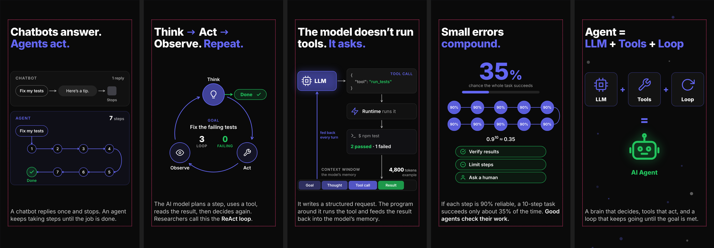

# Remotion video

<p align="center">
  <a href="https://github.com/remotion-dev/logo">
    <picture>
      <source media="(prefers-color-scheme: dark)" srcset="https://github.com/remotion-dev/logo/raw/main/animated-logo-banner-dark.apng">
      
    </picture>
  </a>
</p>

## How AI Agents Work

A 30-second vertical explainer (1080×1920, 30fps) in five scenes:



1. `HookScene`: chatbots answer, agents act
2. `LoopScene`: the Think → Act → Observe (ReAct) loop
3. `ToolScene`: how a tool call travels through the runtime and back into context
4. `CompoundScene`: why 90% per step becomes ~35% over 10 steps, and the guardrails that help
5. `RecapScene`: Agent = LLM + Tools + Loop

`AgentsExplainer` is the full video. Each scene is also registered on its own under
**Scenes** in Studio. Turn on the `showSafeZone` prop in Studio to outline the
area that stays clear of platform UI (150px top, 170px bottom, 60px sides).

## Commands

**Install Dependencies**

```console
npm i --loglevel=error
```

**Start Preview**

```console
npm run dev
```

**Render video**

```console
npx remotion render
```

**Upgrade Remotion**

```console
npx remotion upgrade
```

## Docs

Get started with Remotion by reading the [fundamentals page](https://www.remotion.dev/docs/the-fundamentals).

## Help

We provide help on our [Discord server](https://discord.gg/6VzzNDwUwV).

## Issues

Found an issue with Remotion? [File an issue here](https://github.com/remotion-dev/remotion/issues/new).

## License

Note that for some entities a company license is needed. [Read the terms here](https://github.com/remotion-dev/remotion/blob/main/LICENSE.md).
